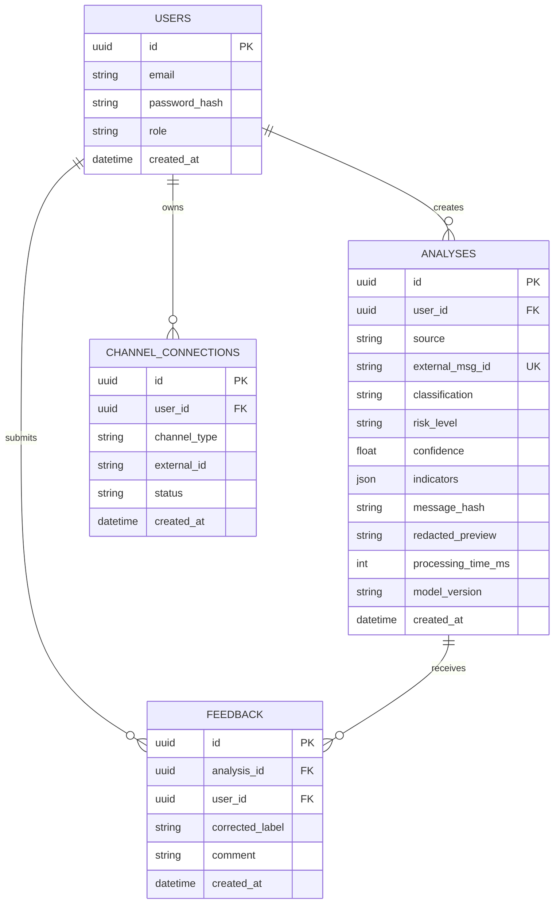

# FraudGuard Entity Relationship Diagram

`external_msg_id` is filled for SMS and Telegram messages and is unique, so a repeated delivery of the same `message_id` does not create a second analysis. Full message text is not stored, only `message_hash` and an optional short `redacted_preview`.
