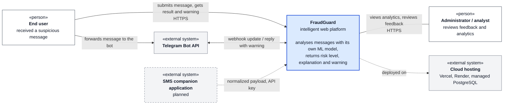

# FraudGuard System Context

The platform is shown as one system. Only people and external systems around it are shown; internal parts are in the component diagram.

Dashed elements are planned extensions, not part of the core web MVP.
