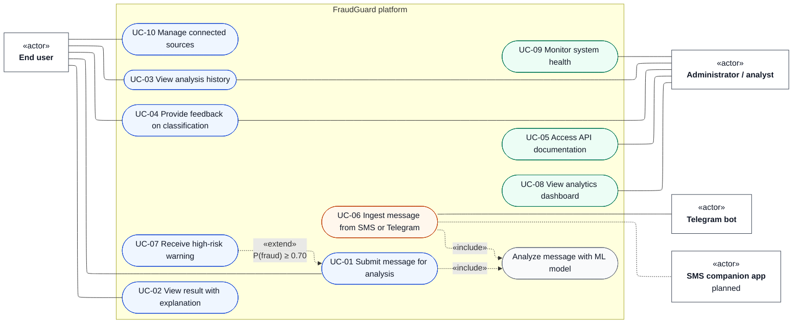

# FraudGuard Use Cases

Use case IDs follow the table in `docs/architecture.md`. Actors are drawn as «actor» boxes, use cases as ovals, associations as plain lines.

UC-06 is an extension of the core web MVP: Telegram bot first, SMS application as a prototype.
