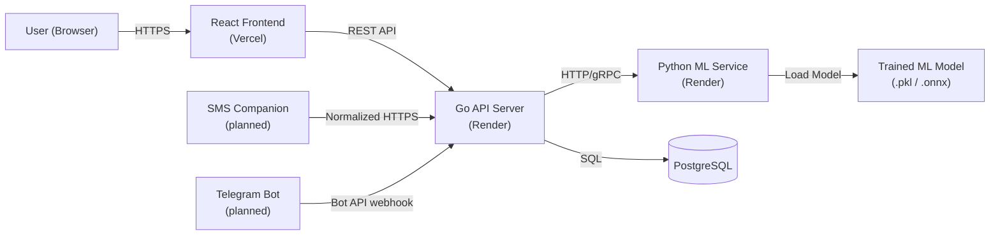
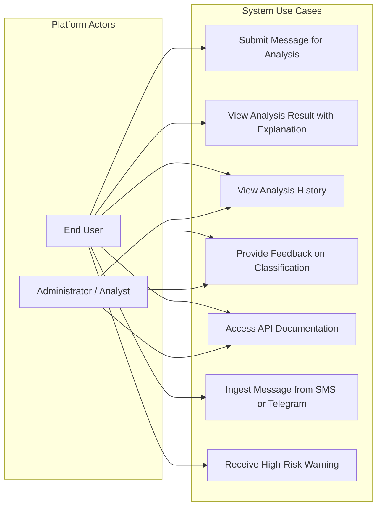
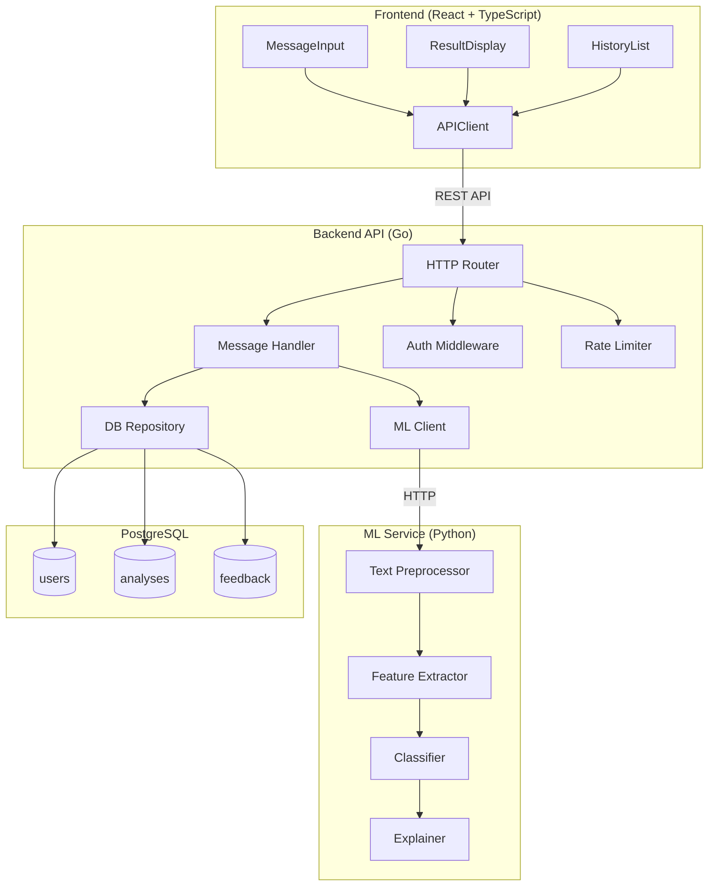
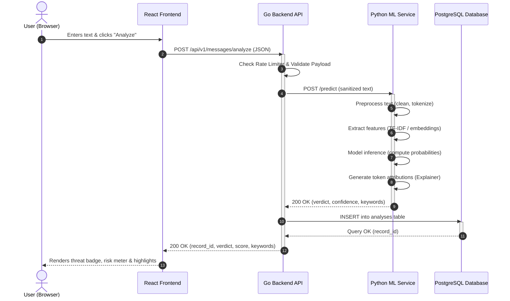
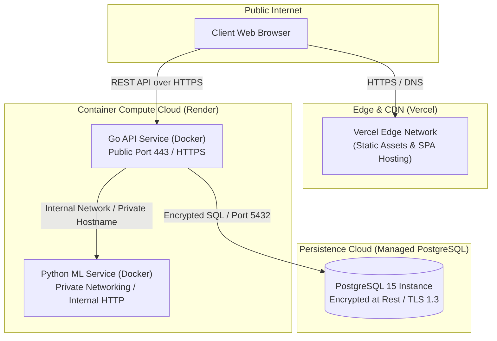

# System Architecture

## 1. Overview

The **Intelligent Web Platform for Fraud Message Detection** is engineered using a modern, loosely coupled three-tier architecture comprising a **React Single-Page Application (SPA)** frontend, a high-throughput **Go REST API backend**, and a specialized **Python Machine Learning (ML) service**. Data persistence, audit logging, and feedback storage are managed by a managed **PostgreSQL** relational database.

```
┌────────────────────────────────────────────────────────────────────────┐
│                             PRESENTATION TIER                          │
│        React 18 + TypeScript SPA (Vercel Global Edge Network)          │
└───────────────────────────────────┬────────────────────────────────────┘
                                    │ HTTPS / REST API
┌───────────────────────────────────▼────────────────────────────────────┐
│                         MESSAGE INGESTION TIER                         │
│   SMS Companion Adapter (planned) · Telegram Bot Adapter (planned)      │
└───────────────────────────────────┬────────────────────────────────────┘
                                    │ Normalized HTTPS payload
┌───────────────────────────────────▼────────────────────────────────────┐
│                             APPLICATION TIER                           │
│        Go API Backend (Gin Engine, High-Throughput Request Gateway)    │
└───────────────────┬────────────────────────────────┬───────────────────┘
                    │ Internal HTTP / JSON           │ SQL / TLS
┌───────────────────▼────────────────────┐  ┌────────▼───────────────────┐
│              INFERENCE TIER            │  │      PERSISTENCE TIER      │
│  Python ML Service (FastAPI / Sklearn) │  │  PostgreSQL Managed DB     │
└────────────────────────────────────────┘  └────────────────────────────┘
```

### Architectural Principles and Design Goals

1. **Separation of Concerns:** Each tier is strictly bounded by clear functional responsibilities. The frontend focuses entirely on user experience and responsive rendering; the Go backend coordinates business logic, request validation, authentication, and persistence; and the Python ML service encapsulates natural language processing (NLP), model inference, and feature attribution.
2. **Polyglot Service Strategy:** 
   - **Go** is selected for the primary API gateway due to its compiled execution speed, low memory footprint, and native goroutine-based concurrency model, ensuring high throughput and sub-millisecond routing overhead.
   - **Python** is selected for the inference service to leverage the mature, battle-tested scientific computing and NLP ecosystem (`scikit-learn`, `numpy`, `pandas`, `joblib`, and transformer toolkits).
   - **React with TypeScript** guarantees end-to-end type safety, modular component reusability, and deterministic client-side state handling.
3. **Stateless Compute Instances:** Both the Go API and Python ML services operate as stateless HTTP services, delegating persistent state entirely to PostgreSQL. This guarantees trivial horizontal scaling and containerized workload mobility across cloud environments.
4. **Fault Tolerance and Isolation:** Isolation between the ML inference engine and the API gateway ensures that heavy computational spikes or model reload operations do not compromise API responsiveness, user session handling, or historical data retrieval.

---

## 2. System Context Diagram

The system context defines the operational perimeter of the platform, identifying external actors, system boundaries, and primary integration interfaces.

### System Context Description

- **User (Browser):** End users (general internet users, corporate employees, or IT helpdesk staff) access the platform via any modern desktop or mobile browser over an encrypted HTTPS connection.
- **External Channel Adapters:** A limited SMS companion application and a Telegram bot may submit messages explicitly made available by the user. These adapters are planned extensions, not a requirement for the core web MVP.
- **Frontend (React + TypeScript):** Hosted on Vercel's global Content Delivery Network (CDN), serving static assets, managing UI state, validating inputs on the client side, and issuing asynchronous REST API calls.
- **Backend (Go API Server):** Hosted on Render, serving as the central orchestration gateway. It terminates client requests, enforces authentication and rate limits, communicates with the internal ML service, and records data in PostgreSQL.
- **ML Service (Python Inference Engine):** Hosted on Render as an internal service. It receives pre-validated text payloads, executes NLP preprocessing, feeds features into a trained classification model, computes feature attributions, and returns structured predictions.
- **Trained ML Model Artifact:** Serialized binary artifact (`.pkl` or `.onnx`) containing trained model weights and vectorizer vocabularies, loaded into memory at container boot time.
- **Database (PostgreSQL):** Relational database managing user credentials, classification audit logs, and human-in-the-loop feedback entries.

### Mermaid Context Diagram



---

## 3. Use Case Diagram

The platform provides a focused set of functional interactions designed for seamless end-user threat evaluation, explainability inspection, and historical review.

### Primary Actors
- **End User / Client:** Individuals seeking rapid risk evaluation of unsolicited text messages, SMS communications, or suspicious emails.
- **Security Analyst / Administrator:** Privileged operators reviewing aggregate system trends, reviewing false-positive/negative feedback, and monitoring model performance.

### Use Case Diagram (Flowchart Representation)



### Use Case Specifications

| Use Case ID | Name | Actor | Preconditions | Main Success Scenario | Postconditions |
| :--- | :--- | :--- | :--- | :--- | :--- |
| **UC-01** | **Submit Message for Analysis** | End User | Network connection available; UI loaded. | User pastes raw text snippet into `MessageInput`, clicks "Analyze", and awaits verdict. | Request transmitted to backend; analysis pipeline triggered. |
| **UC-02** | **View Result with Explanation** | End User | UC-01 completed successfully. | Interface renders classification verdict (Safe / Suspicious / Fraudulent), risk percentage, and highlighted indicator keywords. | User understands threat level and actionable reasoning behind verdict. |
| **UC-03** | **View Analysis History** | End User, Administrator | Authenticated session or local session identifier. | User navigates to History tab; platform displays paginated list of past queries with timestamps, snippets, and verdicts. | User inspects details or deletes past records. |
| **UC-04** | **Provide Feedback on Classification** | End User, Administrator | Existing analysis record present on screen. | User indicates agreement or disagreement (e.g., "False Positive"), optionally providing comments. | Feedback persisted in `feedback` table for offline retraining corpora curation. |
| **UC-05** | **Access API Documentation** | Developer, Analyst | Web browser available. | User navigates to `/api/docs` or `/swagger/index.html`; system renders interactive OpenAPI documentation. | Caller inspects schema definitions and tests endpoints interactively. |
| **UC-06** | **Ingest Message from SMS or Telegram** | Connected Adapter, End User | Adapter is configured and the user explicitly sends or permits the message. | Adapter submits a normalized payload; the backend validates its source and starts the standard analysis pipeline. | The message receives a source-aware analysis record. |
| **UC-07** | **Receive High-Risk Warning** | End User | Analysis completes with a high-risk decision. | The platform displays risk, reasons, and safety advice; an available adapter may return the warning through its channel. | User is warned before opening a link or sharing sensitive data. |

---

## 4. Component Diagram (Draft)

The system is decomposed into four discrete functional domains: the Client Presentation Layer, the API Gateway & Orchestration Layer, the Machine Learning Service Layer, and the Relational Persistence Layer.

### 4.1 Frontend (React + TypeScript)
- **`MessageInput` Component:** Interactive input area featuring real-time character counters, text sanitization, validation feedback, and preset demo templates for quick testing.
- **`ResultDisplay` Component:** High-visibility threat dashboard rendering categorical outcome badges (`Legitimate`, `Suspicious`, `Phishing / Fraud`), numerical confidence percentages, and token-level visual highlights representing high-risk words or phrases.
- **`HistoryList` Component:** Chronological audit component displaying past message submissions, categorization tags, and timestamp metadata with client-side filtering and search capabilities.
- **`APIClient` Service:** Centralized Axios / Fetch HTTP client configured with base URL management, timeout handling, JSON serialization, and unified HTTP error dispatching.

### 4.2 Backend API (Go)
- **`HTTP Router (Gin)`:** High-performance HTTP multiplexer responsible for route registration, parameter binding, CORS configuration, and request logging.
- **`Message Handler`:** Controller layer encapsulating request parsing, schema validation, coordination of calls to the ML Service, and interaction with the database repository.
- **`Auth Middleware`:** Middleware validating JWT bearer tokens or optional session keys, binding user identities to request contexts.
- **`ML Client`:** Dedicated internal HTTP client responsible for communicating with the Python ML microservice, featuring automated timeouts, connection pooling, and circuit breaker policies.
- **`Database Repository`:** Data abstraction layer implementing repository patterns for PostgreSQL queries using parameterized SQL or ORM constructs to prevent SQL injection.
- **`Rate Limiter`:** Memory-efficient token-bucket middleware (or Redis-backed sliding window) preventing volumetric request abuse and denial-of-service threats.
- **`Message Ingestion API`:** Protected endpoint accepting normalized payloads from the planned SMS and Telegram adapters and assigning an idempotency key.
- **`Risk Policy and Notification`:** Converts model output into a user-facing warning without deleting or blocking the original message.

### 4.3 ML Service (Python)
- **`REST API (FastAPI / Flask)`:** Lightweight, asynchronous web framework exposing RESTful endpoints (`POST /predict`, `GET /health`, `POST /explain`).
- **`Text Preprocessor`:** Deterministic NLP cleaning module executing unicode normalization, lowercasing, URL/email token replacement (`<URL>`, `<EMAIL>`), punctuation stripping, and whitespace standardization.
- **`Feature Extractor`:** Transformation layer converting cleaned text tokens into mathematical feature matrices using pretrained **TF-IDF vectorizers** (unigrams + bigrams) or dense contextual word representations.
- **`Classifier`:** Supervised learning classification model (e.g., optimized Logistic Regression, Support Vector Machine, or LightGBM) calculating probability distributions across target fraud classes.
- **`Explainer`:** Post-hoc feature attribution engine (utilizing linear coefficient extraction or LIME-inspired token perturbation) computing token-level contribution scores to explain why a message was flagged.

### 4.4 Database (PostgreSQL)
- **`users` Table:** Stores user credentials, hashed passwords (bcrypt/Argon2), email addresses, authorization roles, and account metadata.
- **`analyses` Table:** Central audit log recording source metadata, optional redacted previews or hashes, classification verdicts, confidence probabilities, response latency, and associated user IDs. Full private message bodies are not retained by default.
- **`feedback` Table:** Human-in-the-loop annotations linked to `analyses`, capturing whether the user agreed with the classification, corrected labels, and submitted commentary.

### Mermaid Component Diagram



---

## 5. Data Flow

The end-to-end data processing lifecycle is synchronous and optimized for low end-to-end latency ($< 500\text{ ms}$).

### Step-by-Step Flow Description

1. **Message Submission:** The user inputs an unverified text message into the React `MessageInput` component, or an available SMS/Telegram adapter submits a normalized payload after explicit user action or permission.
2. **Client Validation & Dispatch:** The web `APIClient` or channel adapter validates the payload and transmits an asynchronous HTTP request to the Go backend.
3. **Gateway Verification:** The Go `HTTP Router` applies rate limiting checks. The `Message Handler` validates the incoming JSON body and extracts request metadata (timestamp, client IP).
4. **ML Service Invocation:** The Go `ML Client` serializes the message text and dispatches an internal HTTP `POST /predict` call to the Python ML microservice.
5. **Preprocessing & Feature Extraction:** The Python `Text Preprocessor` cleans and normalizes the text string, removing noise and converting URLs and phone numbers into standardized tokens. The `Feature Extractor` transforms tokens into numerical vectors.
6. **Inference & Explainability:** The `Classifier` computes class probabilities ($P_{\text{fraud}}, P_{\text{legitimate}}$). The `Explainer` determines the top $k$ tokens that exerted the strongest positive or negative influence on the classification score.
7. **Inference Response:** The Python ML service returns a structured JSON payload containing the predicted label, confidence score, and token-importance list to the Go backend.
8. **Data Persistence:** The Go backend's `DB Repository` executes an asynchronous or transactional SQL `INSERT` into the `analyses` table in PostgreSQL, recording the query, verdict, and generated metadata.
9. **Risk Decision and Notification:** The backend applies the risk policy and creates a warning for high-risk results. If an adapter is available, it returns a concise warning through that channel.
10. **Client Response:** The Go backend packages the analysis result into a standard HTTP 200 JSON response and delivers it to the React frontend.
11. **Visual Result Rendering:** The React `ResultDisplay` component renders the threat badge, confidence bar, and highlighted keywords for the user.

### Sequence Diagram



---

## 6. Technology Stack Summary

The chosen technology stack balances performance, developer velocity, type safety, and analytical capabilities across all layers of the platform:

| Tier / Domain | Technology | Version / Library | Architectural Role & Justification |
| :--- | :--- | :--- | :--- |
| **Frontend Framework** | **React** | 18.x | Component-driven UI development, virtual DOM rendering, and mature ecosystem for responsive SPAs. |
| **Frontend Language** | **TypeScript** | 5.x | Static typing for payload contracts, component props, and compile-time defect reduction. |
| **Styling & Icons** | **Tailwind CSS / Lucide** | Latest | Utility-first, responsive CSS design ensuring high visual consistency and dark/light mode support. |
| **Client HTTP** | **Axios / Fetch** | Standard | Promise-based asynchronous HTTP client with unified request/response interceptors. |
| **Backend Language** | **Go (Golang)** | 1.21+ | High-performance compiled language with minimal memory consumption and native lightweight concurrency. |
| **Backend Web Engine** | **Gin Web Framework** | 1.9+ | High-speed HTTP router and middleware engine featuring radx-tree routing and minimal allocations. |
| **Database ORM / Driver**| **pgx / GORM** | Latest | Robust PostgreSQL driver and query builder supporting connection pooling and prepared statements. |
| **ML Runtime** | **Python** | 3.10+ | Standard ecosystem for machine learning, scientific computing, and natural language processing. |
| **ML Framework** | **FastAPI / Uvicorn** | Latest | Asynchronous, OpenAPI-compliant Python web framework providing rapid JSON serialization. |
| **ML / NLP Libraries** | **scikit-learn, NumPy** | Latest | Optimized text vectorization (TF-IDF), classification pipelines, and statistical model evaluation. |
| **Model Serialization** | **Joblib / ONNX** | Standard | Compact, high-speed binary model persistence format for low-latency memory loading. |
| **Relational Database** | **PostgreSQL** | 15+ | Enterprise-grade ACID-compliant SQL database for reliable transactional persistence and JSONB querying. |
| **Frontend Hosting** | **Vercel** | Cloud Platform | Global CDN edge network with zero-configuration deployments and automated SSL certificate provisioning. |
| **Backend & ML Hosting**| **Render** | Cloud Platform | Managed cloud application platform offering native Docker container execution, health checks, and log streaming. |
| **CI / CD Automation** | **GitHub Actions** | Workflows | Continuous Integration pipelines for linting, automated testing, container building, and deployment triggering. |

---

## 7. Deployment Architecture

The production environment adopts a decoupled cloud deployment model across specialized platforms, optimizing cost, operational overhead, and latency.



### Key Deployment Characteristics

1. **Frontend Hosting (Vercel):** The React SPA is built as an optimized static bundle and distributed across Vercel's global Edge Network. This guarantees rapid initial load times worldwide, automated preview deployments for pull requests, and automated SSL/TLS management.
2. **Backend Gateway (Render):** The Go API backend is packaged as a lightweight, multi-stage Docker image and deployed on Render. Render manages automated health checks, rolling zero-downtime updates, and TLS termination.
3. **ML Inference Service (Render Private Service):** The Python ML service is packaged as a Python-slim container and deployed within Render's private service perimeter. It is accessible solely by the Go backend via private service mesh hostnames (e.g., `http://ml-service:8000`), protecting inference endpoints from public internet exposure.
4. **Managed Database (PostgreSQL):** A managed PostgreSQL instance provides automated daily backups, high availability, point-in-time recovery, and encryption at rest. All database connections from the Go backend mandate SSL (`sslmode=require`).
5. **Configuration Management:** Environment-specific secrets (database connection strings, internal service tokens, JWT signing keys) are injected at runtime via encrypted environment variables, strictly adhering to Twelve-Factor App methodology.

---

> [!NOTE]
> Detailed architectural diagrams in editable format are available in the `/diagrams` directory.
