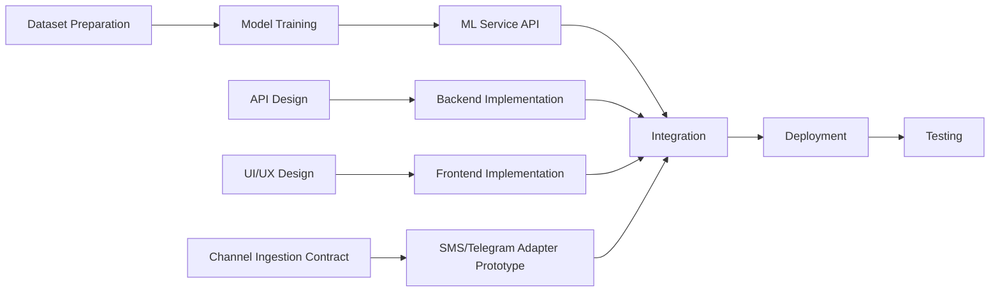

# Project Management

## 1. Team and Responsibilities
| Team Member | Role | Key Responsibilities |
|---|---|---|
| Marat Danial | Backend Developer, DevOps | Go API development, PostgreSQL, CI/CD, Render deployment, load testing, security |
| Abdikasym Nurbakyt | ML Engineer, Frontend Developer | Dataset preparation, ML model training, React/TS frontend, Vercel deployment, UX design |
| Konstantin Latuta | Supervisor | Weekly reviews, architectural guidance, quality assurance |

## 2. Project Management Tools
- **Version Control**: GitHub ([fraud-guard](https://github.com/doni9977/fraud-guard))
- **Task Tracking**: YouTrack project DIP — https://fg-diploma.youtrack.cloud/projects/DIP
- **Communication**: Telegram group + weekly in-person/online meetings with supervisor
- **Documentation**: Markdown files in /docs directory
- **Design**: Figma (for UI/UX mockups)

## 3. Development Workflow
- Every work item is a YouTrack task (DIP-n) with an assignee, priority, due date and acceptance criteria.
- Work is done in a task branch named after the task, e.g. `DIP-7-diagrams`, never directly in `main`.
- Commit messages start with the task ID, e.g. `DIP-7: Add architecture diagrams`.
- Changes reach `main` only through a pull request that references the task and describes how the work was checked. The other team member reviews and merges it.
- The pull request link is added to the YouTrack task; the task is closed only when its acceptance criteria are met.
- Each pre-defense submission is marked with a Git tag: `pre-defense-1`, `pre-defense-2`, `final-pre-defense`.

## 4. Project Milestones
| # | Milestone | Deadline | Deliverables |
|---|---|---|---|
| 1 | Pre-defense 1 | October 24, 2026 | Analysis, design, documentation, architecture, prototype |
| 2 | Pre-defense 2 | To be agreed | Basic ML model, working API, and frontend prototype |
| 3 | Final pre-defense | To be agreed | Complete platform, optimized model, full testing, and documentation |

## 5. Sprint Plan (Pre-defense 1)
| Week | Danial | Nurbakyt |
|---|---|---|
| Oct 6-12 | Project setup, proposal draft | Literature review research |
| Oct 13-19 | Technology comparison, requirements | Literature review, existing systems |
| Oct 20-24 | Architecture, diagrams, verification plan | Prototype, UX mockups, verification plan |

## 6. Risk Management

| # | Risk | Probability | Impact | Mitigation Strategy |
|---|---|---|---|---|
| R1 | Insufficient or biased training dataset | Medium | High | Use multiple public datasets (SMS Spam Collection, Kaggle phishing datasets), apply data augmentation techniques |
| R2 | Low ML model accuracy | Medium | High | Start with well-proven classical models, iteratively improve, consider ensemble methods |
| R3 | Integration issues between Go backend and Python ML service | Medium | Medium | Define clear API contracts early, use Docker for consistent environments |
| R4 | Cloud deployment limitations (free tier) | Low | Medium | Design for minimal resource usage, use efficient model formats (ONNX) |
| R5 | Team member unavailability | Low | High | Cross-training on each other's components, detailed documentation |
| R6 | Scope creep | Medium | Medium | Strict adherence to MoSCoW priorities, regular scope reviews with supervisor |
| R7 | Data privacy concerns with user-submitted messages | Low | High | Implement data retention policy, no permanent storage of message content |
| R8 | SMS or Telegram platform restrictions | Medium | High | Keep the web MVP independent, define a stable ingestion contract, and use a test adapter if a real channel cannot be completed |
| R9 | False positive warning affects user trust | Medium | High | Show confidence and reasons, provide feedback, and warn without deleting or blocking messages |
| R10 | Duplicate or delayed external delivery | Medium | Medium | Use message identifiers, idempotency keys, timeouts, and explicit delivery status |

## 7. Dependencies

## 8. Communication Plan
- **Weekly supervisor meetings**: Progress review, architectural decisions, blocker resolution
- **Daily team sync**: Brief status update via Telegram
- **Code reviews**: All pull requests reviewed before merging
- **Documentation reviews**: Shared Google Drive / GitHub for collaborative editing
